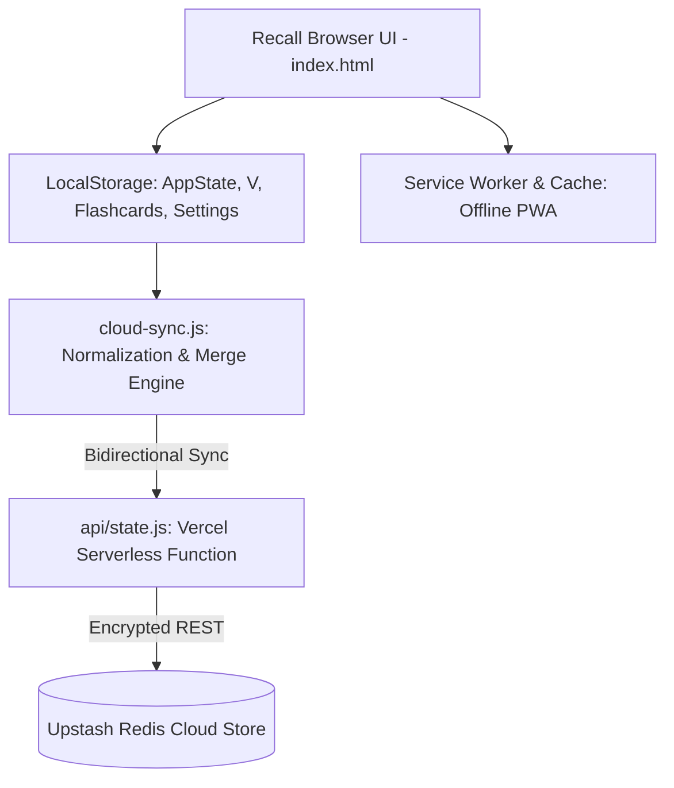

# Recall — IT MCQ & Concept Mastery Platform

Recall is an evidence-based, browser-first cognitive training and exam preparation platform designed for candidates taking the **Tribhuvan University (TU) Institute of Science and Technology (IOST) Master of Information Technology (MIT) Entrance Examination**.

The application prioritizes active recall over passive recognition, adaptive spaced repetition, targeted concept error rescue, and syllabus-calibrated benchmarks across all 19 examinable subjects.

---

## 1. Pedagogical Architecture & Core Learning Engines

Recall is structured around seven interconnected cognitive study engines designed to maximize marks-per-hour return and eliminate the illusion of competence:

### 1.1. Strict Recall-First Pipeline
- **Philosophy**: Prevents the "recognition trap" where multiple-choice options make questions seem familiar before actual memory retrieval has occurred.
- **Implementation**: Default mode conceals options and prompts the user to mentally retrieve (or type) the answer. Options are revealed only upon intentional prompt.
- **Smart Choice-Dependency Detection**: An optimized regex automatically bypasses recall-first when the stem is inherently option-dependent (e.g., *"Which of the following..."*, *"Which statement is TRUE/FALSE..."*, *"Select the invalid option..."*).

### 1.2. Confidence-Calibrated Spaced Repetition (SM-2 Variant)
- **3-Star Confidence Rating**: Every answer is paired with a self-assessed confidence level:
  - `1★ (Guess)`: Low confidence; even if correct, treated as fragile knowledge.
  - `2★ (Fair)`: Moderate confidence; standard interval progression.
  - `3★ (Sure)`: High confidence; accelerated interval scaling when correct.
- **Adaptive Scheduling (`sr()` Engine)**: Computes dynamic review intervals, tracks ease factors, logs mistake counts (`missCount`), and tracks lapses (`lapses`). Fragile or incorrect items cycle back into the daily queue.
- **Session Queue Builder (`buildTodaySession()`)**: Intelligently balances due spaced reviews, weak-topic reinforcements, and new syllabus questions into an achievable daily review target.

### 1.3. Concept Gaps & Error Rescue Dashboard
- **Trap Detection**: Automatically identifies and prioritizes **High-Confidence Traps** (questions answered incorrectly with 3★ confidence).
- **Leech Management**: Surfaces persistent mistakes (questions with 2+ lapses) that need conceptual discrimination rather than continuous MCQ guessing.
- **Discrimination Cues**: Surfaces $A \neq B$ distinguishing rules and memory anchors directly under error items, prompting conceptual comparison.
- **Automated Mastery Graduation**: As soon as a trapped or lapsed question is answered correctly with 3★ confidence, it automatically graduates and vacates the priority rescue queue.

### 1.4. Calibrated 3-Tier Exam Strategy
The 19 syllabus subjects are grouped into calibrated target readiness thresholds based on exam weight, syllabus volume, and return-on-effort:
- **Tier A (Target: 85%) — Verbal & High-Yield Core**:
  - *Subjects*: Introduction to Information Technology (IIT), Management Information System (MIS), E-Commerce (EC), Systems Analysis and Design (SAD), Software Engineering (SE), Web Technology.
  - *Rationale*: Definitional, conceptual, and standardized; high score return per study hour.
- **Tier B (Target: 80%) — Technical Systems & Architecture**:
  - *Subjects*: Database Management System (DBMS), Computer Networks (CN), Operating System (OS), Digital Logic (DL), Artificial Intelligence (AI), Computer Graphics (CG), Microprocessor System (MP).
  - *Rationale*: Core CSIT pillars with high question density; requires clear architectural understanding.
- **Tier C (Target: 75%) — Calculation, Coding & High-Syllabus Ratios**:
  - *Subjects*: C Programming, Object Oriented Programming (C++), Data Structures and Algorithms (DSA), Calculus & Functions, Linear & Abstract Algebra, Statistics & Probability.
  - *Rationale*: Time-intensive calculations and syntax tracing; target 75% solid foundation rather than diminishing returns from exhaustive edge cases.

### 1.5. Syllabus Study & Coverage Engine
- **TU MIT Syllabus Inventory**: 1,036 granular topics across 160 units in all 19 subjects, defined in `mit_entrance_syllabus.json`.
- **Mathematical Topic Weighting**: Each topic has an assigned importance level ($1-6$), calculating its proportional share in the unit (`share_in_unit_pct`) and contribution to the total 100-mark entrance exam (`global_weight_pct`).
- **Unit Coverage Radar**: Real-time tracking of practiced vs. solid units across all subjects.
- **Unit Drills**: On-demand drilling filtered specifically to a single syllabus unit or topic.
- **Strict Syllabus Isolation**: Enforces exact `topic_id` mapping—preventing artificial or hallucinated topic associations.

### 1.6. Dual-Mode Concept Flashcard System (Phase 5)
- **Bidirectional Question-Card Linking**: Turn any challenging MCQ into a dedicated concept card with one click. Flashcards maintain a persistent pointer (`sourceQuestionId`) to their origin question.
- **Dedicated Spaced Review**: Concept flashcards have their own spaced repetition schedule independent of MCQ attempts.
- **Tombstone Sync Safety**: Deleted cards are recorded in `CARD_TOMBSTONES` to prevent accidental resurrection during multi-device synchronization.

### 1.7. Timed Mock Exam Simulation
- **Full Exam Simulation**: 100-question timed mocks with realistic subject weight distribution mirroring the TU IOST entrance format.
- **In-Mock Question Triage**: Learners can edit, delete, mark "too hard", or tag questions without invalidating the mock; timer cleanly pauses during question editing.
- **Comprehensive Score Analysis**: In-depth breakdown by subject tier, timing analysis, and mock history tracking with personal best celebration triggers.

### 1.8. Dignified Milestone Celebrations
- **Authentic Motivation**: Clean, distraction-free modal dialog celebrating score milestones (e.g., reaching 85% in a Tier A subject, beating a mock personal best).
- **Curated Wisdom**: Displays authentic quotes on mastery, focus, and computer science discipline without childish gamification or disruptive browser alerts.

---

## 2. Data Persistence & Synchronization Architecture

Recall operates as an offline-first Progressive Web App (PWA) with multi-device state synchronization:

- **Local Storage (`AppState`)**: Stores attempts history (`V`), spaced repetition metadata, concept flashcards, question overrides, mock histories, and custom settings.
- **Non-Destructive Merge**: `cloud-sync.js` performs a conflict-free merge of question histories (`V`), taking the union of attempts, latest review dates, and max intervals.
- **Tombstone Synchronization**: Explicit deletion tombstones (`CARD_TOMBSTONES`, deleted question hashes) ensure that removals on one device are propagated correctly without resurrection.
- **JSON Backup & Restore**: Full system state can be exported to or restored from a portable JSON snapshot at any time.

---

## 3. Inline AI Integration (Gemini API)

- **Configurable BYOK (Bring Your Own Key)**: Configurable securely in client settings without exposing API keys.
- **On-Demand Conceptual Explanations**: Context-aware prompts generate concise conceptual explanations, discriminating rules, and common distractor pitfalls for any question.
- **Concept Card Generation**: Automatically synthesizes question stems and explanations into clean flashcard front/back pairs.

---

## 4. Repository Structure & File Map

| File | Role & Contents |
|---|---|
| `index.html` | Complete SPA application: UI markup, CSS design system, inline state management, 7 study engines, PWA integration, and modals. |
| `question_bank.json` | Bundled repository of 1,866 curated MCQs with verified answers, explanations, syllabus `topic_id` tags, and priority levels. |
| `mit_entrance_syllabus.json` | Canonical syllabus database: 19 subjects, 160 units, 1,036 topics with calculated weights and study guidance. |
| `MIT_Entrance_Scope_Guide.md` | Strategic handbook: Exam structure, preparation roadmap, recall webs, confusable pairs, and authoring guidelines. |
| `cloud-sync.js` | State normalization, bi-directional 3-way merge logic, and cloud synchronization client. |
| `api/state.js` | Vercel serverless function managing secure cloud read/write operations against Upstash Redis. |
| `sw.js` & `manifest.json` | Service Worker caching and PWA manifest for 100% offline functionality. |
| `package.json` | Node dependencies (@upstash/redis) and dev runner scripts (`vercel dev`). |
| `AGENTS.md` | AI pairing instructions, architectural map, and safe-change rules. |

---

## 5. Engineering & Modification Principles

1. **Single-File Integrity**: All application UI and logic reside intentionally within `index.html`. Do not arbitrarily split the codebase into external modules.
2. **Preserve User History**: Never wipe or break the shape of `V` (question attempt history). State transformations must always be additive, backwards-compatible, and non-destructive.
3. **Exact Syllabus IDs**: Only tag questions with verified `topic_id` values from `mit_entrance_syllabus.json`. Never hallucinate or infer loose topic tags.
4. **Tombstone Safety**: Always register question and card deletions in their respective tombstone registries to maintain consistency across cloud sync.
5. **No Blind Tests on Production Port**: Port 8080 is reserved for live local user study connected to Upstash Redis. Never restart or execute intrusive automated tests against active sessions.
